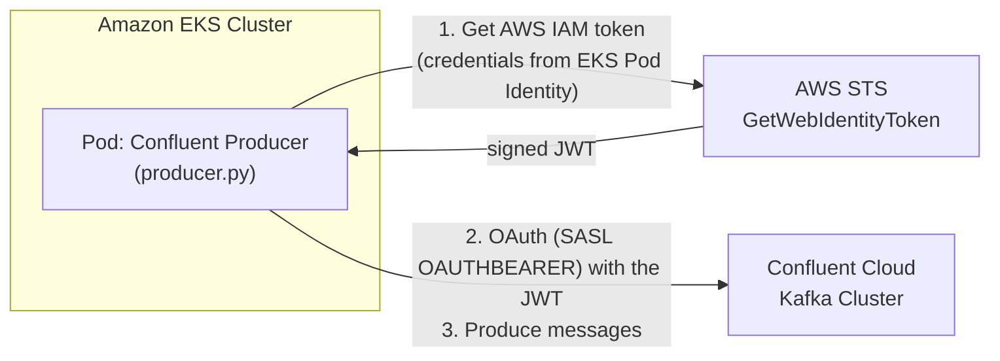
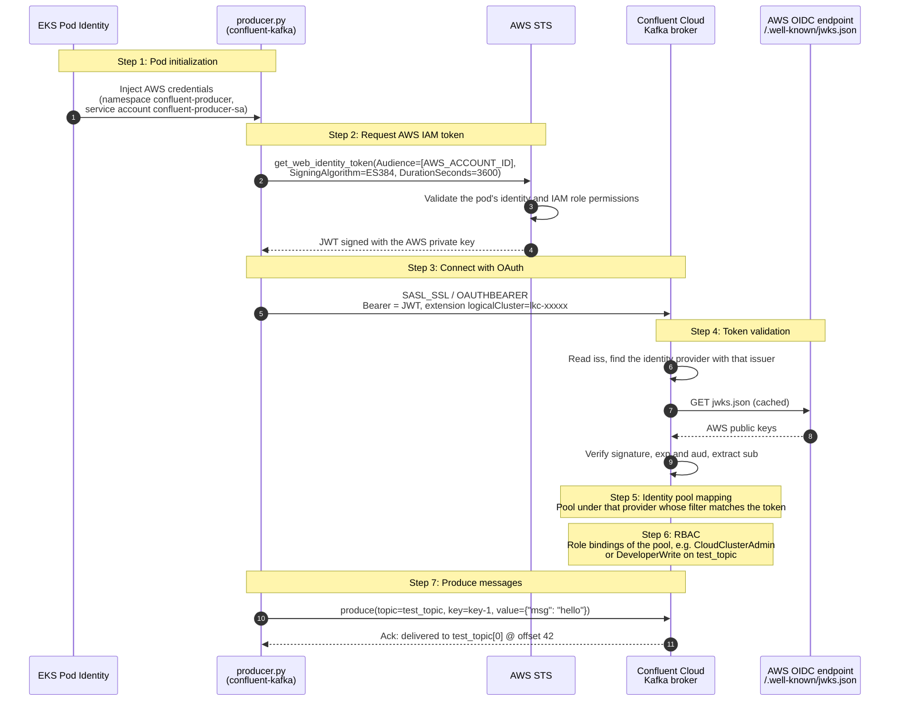

# Confluent Cloud with AWS IAM Authentication - Complete Example

A simple, complete example of using AWS IAM authentication with Confluent Cloud from Amazon EKS. This is example code for educational purposes.

## Repository Contents

This README walks through the **EKS producer** example in the repository root. The repository also contains:

| Path | What it is |
| --- | --- |
| [`aws-iam-hub-spoke-test/aws-iam-oauth-hub-spoke.md`](aws-iam-hub-spoke-test/aws-iam-oauth-hub-spoke.md) | Design: a hub-and-spoke layout where many AWS accounts get their Confluent Cloud tokens through **one** token-minting hub account, so Confluent trusts a single AWS IAM identity provider. Covers ECS/EKS wiring, Lambda consumers, guardrails, scaling limits and operations. |
| [`aws-iam-hub-spoke-test/`](aws-iam-hub-spoke-test/README.md) | A single-account Terraform test of that design: a hub role under `/kafka/` with audience and duration caps, a runtime role that assumes it, a Confluent identity pool pinned to the hub role ARN, and a test Lambda that logs the decoded token claims. |
| [`lambda-entra-consumer/`](lambda-entra-consumer/README.md) | A Lambda consumer using the native Lambda Kafka trigger (event source mapping) with **Azure Entra ID** OAuth (client credentials), deployed with Terraform. This is the recommended Lambda consumer pattern where the AWS IAM hub can't be used. |

Which authentication fits which compute:

| Compute | Recommended authentication |
| --- | --- |
| EKS, ECS, EC2 (your own Kafka client) | AWS IAM OAuth. Use the hub-and-spoke layout once there are multiple AWS accounts. |
| Lambda consumer | The native Kafka trigger (event source mapping), which can't assume a hub role. Use an external IdP such as Entra ID (`lambda-entra-consumer/`), or per-account AWS IAM federation. |

## What This Example Demonstrates

- Python Kafka producer running on Amazon EKS
- EKS Pod Identity for automatic credential management with AWS IAM
- OAuth token generation using AWS STS
- Complete setup automation with shell scripts


## What's In This Folder

- **`producer.py`** - Python Kafka producer application with AWS IAM OAuth
- **`requirements.txt`** - Python dependencies
- **`Dockerfile`** - Container image definition
- **`setup-aws.sh`** - Automated AWS infrastructure setup script
- **`build-and-push.sh`** - Script to build and push Docker image to ECR
- **`deploy.sh`** - Script to deploy application to EKS
- **`kubernetes/`** - Kubernetes manifests
  - **`namespace.yaml`** - Kubernetes namespace
  - **`serviceaccount.yaml`** - ServiceAccount for Pod Identity
  - **`configmap.yaml`** - Application configuration
  - **`job.yaml`** - One-time job deployment
  - **`deployment.yaml`** - Continuous deployment
- **`lambda-entra-consumer/`** - Separate example: Lambda consumer with Entra ID OAuth (see [Repository Contents](#repository-contents))
- **`aws-iam-hub-spoke-test/aws-iam-oauth-hub-spoke.md`** - Hub-and-spoke design for many AWS accounts
- **`aws-iam-hub-spoke-test/`** - Single-account test of the hub-and-spoke design

## What This Example Produces

This is a **demonstration producer** designed to validate AWS IAM authentication to Confluent Cloud. Here's what it does:

### Message Behavior

- **Produces a fixed number of messages** (default: 100, configurable via `MESSAGE_COUNT` env var)
- **Then exits** - this is a one-shot demo, not a continuous streaming application
- **Rate-limited** to ~10 messages/second (0.1s delay between messages)
- **Execution time**: ~10 seconds for 100 messages

### Message Format

Each message is a JSON payload with the following structure:

```json
{
  "timestamp": "2024-03-15T10:30:45.123456+00:00",
  "message_number": 42,
  "value": 73,
  "source": "aws-iam-producer"
}
```

**Fields:**
- **`timestamp`**: UTC timestamp when the message was created (ISO 8601 format)
- **`message_number`**: Sequence number (1 to MESSAGE_COUNT)
- **`value`**: Random integer between 1 and 100
- **`source`**: Always `"aws-iam-producer"` to identify the producer

**Message Key**: Each message has a unique key in the format `key-{N}` where N is the message number. Since keys are unique, messages will be distributed across topic partitions based on key hash.

### Deployment Modes

- **Job** (recommended for testing): Runs once, produces messages, and exits. Pod status will show "Completed".
- **Deployment**: Runs continuously, but since the producer exits after sending messages, the pod will restart repeatedly. This mode is included for reference but not ideal for this specific demo code.

For a production streaming application, you'd modify `producer.py` to run in a continuous loop rather than exiting after N messages.

## Architecture

### High-Level Overview



### Detailed Authentication Workflow



The JWT returned by STS in step 2 looks like this (simplified):

```json
{
  "header":  { "alg": "ES384", "kid": "abcd1234...", "typ": "JWT" },
  "payload": {
    "iss": "https://UUID.tokens.sts.global.api.aws",
    "sub": "arn:aws:iam::123456789012:role/<the pod's IAM role>",
    "aud": "123456789012",
    "exp": 1234567890,
    "iat": 1234564290,
    "https://sts.amazonaws.com/": { "aws_account": "123456789012", "org_id": "o-...", "...": "..." }
  }
}
```

The JWKS document fetched in step 4 (`https://UUID.tokens.sts.global.api.aws/.well-known/jwks.json`) holds the AWS public keys, for example `{"keys": [{"kid": "abcd1234...", "kty": "EC", "use": "sig", "crv": "P-384", "x": "...", "y": "..."}]}`.

**Key points:**

- No API keys or secrets are stored anywhere.
- AWS credentials are managed automatically by EKS Pod Identity.
- JWT tokens are short-lived (15–60 minutes) and refreshed automatically.
- Token validation uses the standard OIDC/OAuth flow.
- Identity pools map token claims to Kafka permissions.
- The Kafka client handles all authentication transparently.

## Before You Begin

Before starting this example, ensure you have the following prerequisites in place.

### Required Tools

- **Python 3.8+** - Required for local development and testing
  ```bash
  python3 --version  # Should be 3.8 or higher
  ```
- **AWS CLI** (v2+) - [Install Guide](https://docs.aws.amazon.com/cli/latest/userguide/getting-started-install.html)
  ```bash
  aws --version      # Should be 2.x+
  ```
- **kubectl** - [Install Guide](https://kubernetes.io/docs/tasks/tools/)
  ```bash
  kubectl version --client
  ```
- **eksctl** - [Install Guide](https://eksctl.io/installation/)
  ```bash
  eksctl version
  ```
- **Docker** - [Install Guide](https://docs.docker.com/get-docker/)
  ```bash
  docker --version
  ```

### AWS Account Requirements

Your AWS account must have:

- **Administrative access** or permissions to create:
  - EKS clusters
  - IAM roles and policies
  - ECR repositories
  - Pod Identity associations
  
- **AWS CLI configured** with valid credentials:
  ```bash
  aws configure
  # Or use AWS SSO: aws sso login
  
  # Verify access:
  aws sts get-caller-identity
  ```

- **Outbound Identity Federation enabled** (see Step 1 below)
  - This feature must be explicitly enabled in your AWS account
  - Creates a unique OIDC issuer URL for your account
  - Required permission: `iam:CreateOutboundIdentityFederation`

### Confluent Cloud Requirements

You'll need:

- **Active Confluent Cloud account** - [Sign up here](https://confluent.cloud/signup)
- **Organization Admin access** - Required to create OAuth identity providers
- **A Kafka cluster** - Can be in any cloud provider (AWS, Azure, GCP)
- **Cluster information**:
  - Bootstrap server (e.g., `pkc-xxxxx.us-west-2.aws.confluent.cloud:9092`)
  - Logical cluster ID (starts with `lkc-`, e.g., `lkc-abc123`)
  - Kafka topic name

### Network Requirements

The EKS cluster needs **outbound internet access** to communicate with:

1. **Confluent Cloud Kafka brokers** (port 9092)
   - Example: `pkc-xxxxx.us-west-2.aws.confluent.cloud:9092`
   
2. **AWS STS endpoints** for token generation
   - Example: `sts.us-west-2.amazonaws.com` (HTTPS port 443)
   
3. **AWS Outbound Identity Federation JWKS endpoint**
   - Example: `https://{UUID}.tokens.sts.global.api.aws/.well-known/jwks.json`

**Important**: The `setup-aws.sh` script creates an EKS cluster with:
- **3 NAT Gateways** (one per availability zone) - **This is a paid AWS resource**
- Public and private subnets
- Internet Gateway for outbound connectivity

### Python Dependencies

This example requires:

- **`confluent-kafka>=2.3.0`** - Kafka client library with SASL OAUTHBEARER support
- **`boto3>=1.41.0`** - AWS SDK for Python

These are automatically installed in the Docker container via `requirements.txt`.

For local testing:
```bash
pip install -r requirements.txt
```

## Step 1: Enable AWS IAM Outbound Identity Federation

### 1.1 Enable the Feature

1. Open the [AWS IAM Console](https://console.aws.amazon.com/iam/)
2. Navigate to **Access management** → **Account settings**
3. Find **Outbound identity federation** section
4. Click **Enable**
5. AWS generates a unique issuer URL for your account:
   - **Issuer**: `https://{UUID}.tokens.sts.global.api.aws`
   - **JWKS URI**: `https://{UUID}.tokens.sts.global.api.aws/.well-known/jwks.json`
6. **Save these URLs** — you'll need them for Confluent Cloud setup

> **Note:** The `{UUID}` is a unique identifier generated by AWS for your account. It is **not** your AWS account ID.

### 1.2 Verify the Endpoints Are Working

Test that your OIDC endpoints are accessible:

```bash
# Replace {UUID} with your actual UUID from step 1.1
curl -s "https://{UUID}.tokens.sts.global.api.aws/.well-known/openid-configuration" | python3 -m json.tool
```

You should see a JSON response with `issuer`, `jwks_uri`, and `token_endpoint` fields.

**Example response:**
```json
{
  "issuer": "https://12345678-1234-1234-1234-123456789abc.tokens.sts.global.api.aws",
  "jwks_uri": "https://12345678-1234-1234-1234-123456789abc.tokens.sts.global.api.aws/.well-known/jwks.json",
  ...
}
```

## Step 2: Configure Confluent Cloud OAuth Identity Provider

Before setting up AWS resources, you need to configure Confluent Cloud to accept your AWS IAM tenant as an identity provider.

### 2.1 Get Your AWS Account ID

```bash
aws sts get-caller-identity --query Account --output text
```

Save this value - you'll need it in the next steps.

### 2.2 Add AWS IAM Identity Provider in Confluent Cloud

1. Log in to [Confluent Cloud](https://confluent.cloud)
2. Go to **Accounts & Access** → **Workload identities**
3. Click **Add provider**
4. Select **OAuth/OIDC**
5. Configure the provider:

   **Basic Settings:**
   - **Name:** `AWS IAM` (or any descriptive name)
   - **Description:** `AWS STS identity provider for EKS`

   **Identity Provider Settings:**
   
   Use the issuer and JWKS URI from **Step 1** (these contain a UUID, not your AWS account ID):
   
   - **Issuer:** `https://{UUID}.tokens.sts.global.api.aws`
   - **JWKS URI:** `https://{UUID}.tokens.sts.global.api.aws/.well-known/jwks.json`

6. Click **Save**


### 2.3 Create Identity Pool

After creating the provider:

1. Click on the provider you just created
2. Go to **Identity pools** tab
3. Click **Add pool**
4. Configure the pool:
   - **Name:** `aws-eks-producer` (any descriptive name; Confluent Cloud generates the pool ID, for example `pool-AbC1`)
   - **Description:** `AWS IAM credentials for EKS pods`
   - **Identity claim:** `claims.sub`
   - **Filter:** pin the exact IAM role the pod runs as. The token's `sub` claim is that role's ARN:

     ```text
     claims.sub == "arn:aws:iam::{YOUR_AWS_ACCOUNT_ID}:role/ConfluentProducerRole"
     ```

     `ConfluentProducerRole` is the role `setup-aws.sh` creates. A filter of `true` accepts every token from your AWS account's issuer; use it only for a quick test.

### 2.4 Grant Permissions to Identity Pool

1. Go to your **Kafka cluster** → **Data access**
2. Click **Add role binding**
3. Configure permissions:
   - **Role:** `CloudClusterAdmin` (or select a suitable topic-level role)
4. Click **Save**

### 2.5 Note Your Cluster Information

You'll need these values for the next steps:

```bash
# From Cluster Settings → General
BOOTSTRAP_SERVERS="pkc-xxxxx.region.aws.confluent.cloud:9092"

# From Cluster Settings → General (look for "Cluster ID")
LOGICAL_CLUSTER="lkc-xxxxxx"
```

## Step 3: Set Up AWS Infrastructure

Run the automated setup script:

```bash
# Make script executable
chmod +x setup-aws.sh

# Run setup (takes 15-20 minutes due to EKS cluster creation)
./setup-aws.sh
```

This script creates:
- EKS cluster with Pod Identity addon
- ECR repository for Docker images
- IAM role with STS and ECR permissions
- Pod Identity association
- Kubernetes namespace and ServiceAccount

**Output:** Configuration is saved to `.aws-config` for use by other scripts.

## Step 4: Configure Application Settings

Edit `kubernetes/configmap.yaml` and replace the placeholder values:

```yaml
data:
  # From Step 2.5 - your Confluent Cloud cluster
  BOOTSTRAP_SERVERS: "pkc-xxxxx.us-west-2.aws.confluent.cloud:9092"
  LOGICAL_CLUSTER: "lkc-xxxxxx"
  KAFKA_TOPIC: "test_topic"  # Or your preferred topic name

  # From Step 2.1 - your AWS account ID
  AWS_ACCOUNT_ID: "123456789012"
  
  # AWS region (should match your cluster)
  AWS_DEFAULT_REGION: "us-west-2"
  
  # Optional: number of test messages to produce
  MESSAGE_COUNT: "100"
```

## Step 5: Build and Push Docker Image

Build the Docker image and push to ECR:

```bash
# Make script executable
chmod +x build-and-push.sh

# Build and push image to ECR
./build-and-push.sh
```

This script:
1. Authenticates with Amazon ECR
2. Builds the Docker image for AMD64 platform
3. Tags and pushes to your ECR repository

## Step 6: Deploy to EKS

First, apply your ConfigMap changes:

```bash
kubectl apply -f kubernetes/configmap.yaml
```

Then deploy the producer:

```bash
# Make script executable
chmod +x deploy.sh

# Deploy as a one-time Job (recommended for testing)
./deploy.sh job

# OR deploy as a continuous Deployment
./deploy.sh deployment
```

## Step 7: Verify It Works

### Check Job Status

```bash
# View job status
kubectl get jobs -n confluent-producer

# View pod logs
kubectl logs -n confluent-producer -l app=confluent-producer -f
```

### Expected Output

You should see logs like:

```
==========================================
Confluent Cloud Producer with AWS IAM Authentication
==========================================

[timestamp] Initializing producer...
  Bootstrap: pkc-xxxxx.us-west-2.aws.confluent.cloud:9092
  Cluster: lkc-xxxxxx
  AWS Account: 123456789012

[timestamp] Requesting AWS IAM token...
[timestamp] ✅ Got token (expires in 3600s)

[timestamp] Starting to produce 100 messages to 'test_topic'

[timestamp] ✅ Message delivered to test_topic[0] @ offset 42
[timestamp] ✅ Message delivered to test_topic[1] @ offset 15
...

[timestamp] Flushing remaining messages...

==========================================
✅ SUCCESS! All messages produced using AWS IAM authentication
==========================================
```

### Verify in Confluent Cloud

1. Go to your cluster in Confluent Cloud
2. Navigate to **Topics** → Select your topic
3. Click **Messages** tab
4. You should see the test messages produced by the application

## Troubleshooting

### Common Confusion: UUID vs AWS Account ID

**IMPORTANT:** There are TWO different values to keep track of:

1. **UUID (from Step 1)** - Used for:
   - Issuer URL in Confluent Cloud: `https://{UUID}.tokens.sts.global.api.aws`
   - JWKS URI in Confluent Cloud: `https://{UUID}.tokens.sts.global.api.aws/.well-known/jwks.json`
   - Format: `12345678-1234-1234-1234-123456789abc` (hyphenated)

2. **AWS Account ID (from Step 2.1)** - Used for:
   - ConfigMap `AWS_ACCOUNT_ID` setting (the producer uses it as the token audience, `aud`)
   - The role ARN in the identity pool filter (`arn:aws:iam::{ACCOUNT_ID}:role/ConfluentProducerRole`)
   - Format: `123456789012` (12 digits, no hyphens)

The identity pool ID itself is generated by Confluent Cloud (`pool-xxxx`); it is not your AWS account ID.

**Do NOT mix these up!** The issuer URL uses the UUID, not the AWS account ID.

### OAuth Identity Provider Issues

**Error:** `Authentication failed`

Check:
1. **ConfigMap has correct AWS_ACCOUNT_ID:**
   ```bash
   kubectl get configmap confluent-producer-config -n confluent-producer -o yaml
   ```

**Error:** `Identity pool not found`

- Ensure you created the identity pool in Step 2.3
- Ensure that the claims from the AWS token matches at least one identity pool based on the configured filter

**Error:** `JWT_HEADER_KID_LOOKUP_FAILED`

This means Confluent Cloud cannot verify the JWT signature. Check:

1. **JWKS endpoint is reachable:**
   ```bash
   curl -s "https://{UUID}.tokens.sts.global.api.aws/.well-known/jwks.json"
   ```

2. **Wait a few minutes** after creating a new Identity Provider — JWKS key caching may take time

3. **Verify outbound identity federation is enabled:**
   - AWS IAM Console → Account settings → Outbound identity federation should show "Enabled"

### Pod Identity Issues

**Error:** `Unable to locate credentials`

Check Pod Identity association:
```bash
source .aws-config

aws eks list-pod-identity-associations \
  --cluster-name "$CLUSTER_NAME" \
  --region "$AWS_REGION"
```

Verify the association exists for:
- Namespace: `confluent-producer`
- ServiceAccount: `confluent-producer-sa`

**Error:** `AccessDenied for GetWebIdentityToken`

Check IAM role permissions:
```bash
source .aws-config

aws iam get-role-policy \
  --role-name "$ROLE_NAME" \
  --policy-name STSAccess
```

Should include: `sts:GetWebIdentityToken`

### Connection Issues

**Error:** `Failed to connect to broker`

1. **Check bootstrap servers:**
   ```bash
   kubectl get configmap confluent-producer-config -n confluent-producer -o yaml | grep BOOTSTRAP
   ```

2. **Verify from pod:**
   ```bash
   kubectl run -it --rm debug --image=alpine --restart=Never -n confluent-producer -- sh
   # apk add curl
   # curl -v telnet://pkc-xxxxx.us-west-2.aws.confluent.cloud:9092
   ```

3. **Check Confluent Cloud cluster status** in the web console

### Permission Issues

**Error:** `Not authorized to access topics`

1. Go to Confluent Cloud → Your Cluster → **Data access**
2. Verify role binding exists for your identity pool
3. Check the role has produce permissions for your topic

### Image Build/Push Issues

**Error:** `unauthorized: authentication required`

Re-authenticate with ECR:
```bash
source .aws-config

aws ecr get-login-password --region "$AWS_REGION" | \
  docker login --username AWS --password-stdin \
  "$AWS_ACCOUNT_ID.dkr.ecr.$AWS_REGION.amazonaws.com"
```

**Error:** `repository does not exist`

Create the ECR repository:
```bash
source .aws-config

aws ecr create-repository \
  --repository-name "$ECR_REPO" \
  --region "$AWS_REGION"
```

### Debug Pod Logs

Get detailed logs:
```bash
# Job logs
kubectl logs -n confluent-producer -l app=confluent-producer -f

# Describe pod for events
kubectl describe pod -n confluent-producer -l app=confluent-producer

# Check pod environment variables
kubectl exec -n confluent-producer -l app=confluent-producer -- env | grep -E 'BOOTSTRAP|CLUSTER|AWS'
```

## Alternative: Using Confluent CLI

You can also create the identity provider and pool using the Confluent CLI instead of the web UI:

```bash
# Create identity provider (replace {UUID} with your value from Step 1)
confluent iam provider create "AWS-IAM" \
  --description "AWS IAM outbound identity federation for EKS" \
  --issuer-uri "https://{UUID}.tokens.sts.global.api.aws" \
  --jwks-uri "https://{UUID}.tokens.sts.global.api.aws/.well-known/jwks.json" \
  --identity-claim "claims.sub"

# Note the provider ID (e.g., op-xxxxx) from the output

# Create identity pool (replace {YOUR_AWS_ACCOUNT_ID} with your AWS account ID)
confluent iam pool create "AWS-Pool" \
  --provider <PROVIDER_ID> \
  --description "Identity pool for AWS IAM principals from EKS" \
  --identity-claim "claims.sub" \
  --filter 'claims.sub == "arn:aws:iam::{YOUR_AWS_ACCOUNT_ID}:role/ConfluentProducerRole"'

# Note the pool ID (e.g., pool-xxxxx) from the output

# Grant access to your cluster
confluent iam rbac role-binding create \
  --principal "User:<POOL_ID>" \
  --role CloudClusterAdmin \
  --environment <ENV_ID> \
  --cloud-cluster <CLUSTER_ID>
```

## Cleanup

Delete all AWS resources:

```bash
source .aws-config

# Delete Kubernetes resources
kubectl delete namespace confluent-producer

# Delete Pod Identity association
aws eks delete-pod-identity-association \
  --cluster-name "$CLUSTER_NAME" \
  --association-id "$ASSOCIATION_ID" \
  --region "$AWS_REGION"

# Delete EKS cluster (takes 10-15 minutes)
eksctl delete cluster --name "$CLUSTER_NAME" --region "$AWS_REGION"

# Delete IAM role and policies
aws iam delete-role-policy --role-name "$ROLE_NAME" --policy-name STSAccess
aws iam delete-role-policy --role-name "$ROLE_NAME" --policy-name ECRAccess
aws iam delete-role --role-name "$ROLE_NAME"

# Delete ECR repository
aws ecr delete-repository \
  --repository-name "$ECR_REPO" \
  --region "$AWS_REGION" \
  --force

# Remove local config
rm -f .aws-config

**In Confluent Cloud:**
1. Go to **Accounts & Access** → **Workload identities**
2. Delete the AWS IAM provider identity pools, then the provider itself

```


## Learn More

- [AWS IAM Outbound Identity Federation](https://docs.aws.amazon.com/IAM/latest/UserGuide/id_roles_providers_outbound_getting_started.html)
- [Confluent Cloud Identity Providers](https://docs.confluent.io/cloud/current/security/authenticate/workload-identities/identity-providers/oauth/identity-providers.html)
- [Confluent Cloud Identity Pools](https://docs.confluent.io/cloud/current/security/authenticate/workload-identities/identity-providers/oauth/identity-pools.html)
- [Confluent Cloud OAuth Documentation](https://docs.confluent.io/cloud/current/access-management/authenticate/oauth/overview.html)
- [AWS EKS Pod Identity Documentation](https://docs.aws.amazon.com/eks/latest/userguide/pod-identities.html)
- [AWS STS GetWebIdentityToken API](https://docs.aws.amazon.com/STS/latest/APIReference/API_GetWebIdentityToken.html)
- [confluent-kafka-python Documentation](https://docs.confluent.io/kafka-clients/python/current/overview.html)
