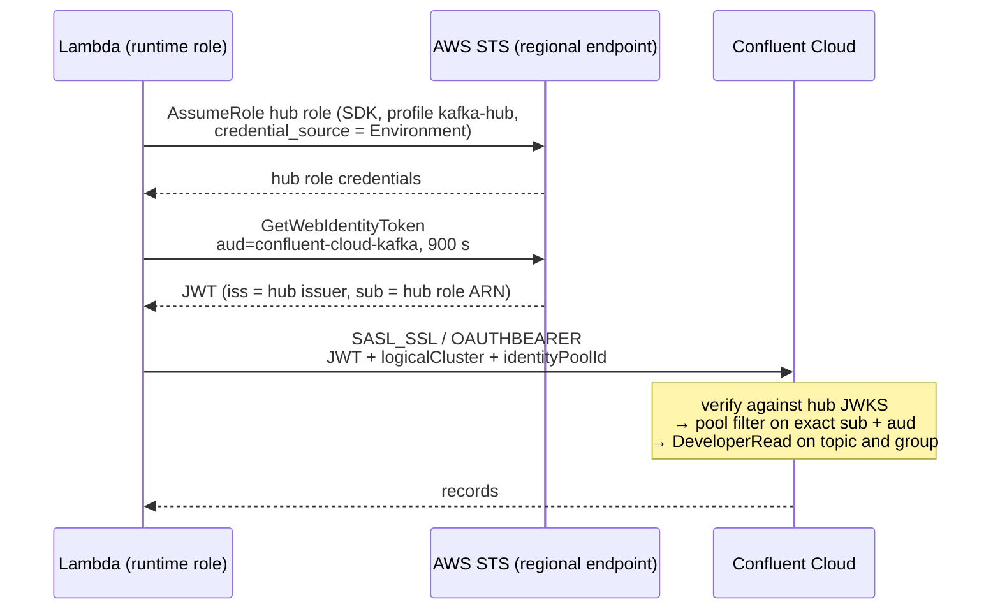
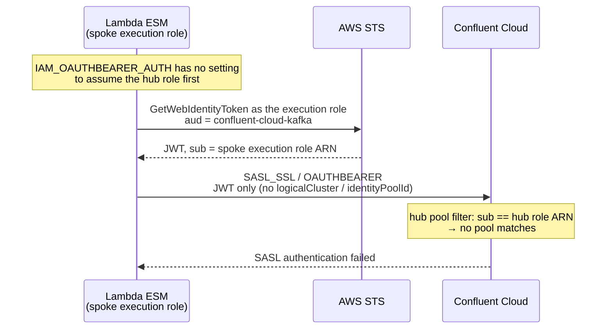

# Hub-and-spoke AWS IAM OAuth: single-account test

A test of the design in [aws-iam-oauth-hub-spoke.md](aws-iam-oauth-hub-spoke.md) using **one** AWS account. That account plays both roles:

- **Hub:** the account with outbound identity federation enabled. It holds the hub role `role/kafka/{env}-{workload}`.
- **Spoke:** the same account. It holds the Lambda execution role, which acts as the runtime role.



**The test Lambda runs its own Kafka client (self-polling) only to exercise the hub hop.** It is not a recommended pattern for Lambda consumers, which should use the native Kafka trigger (ESM). The ESM can't assume a hub role. See [Lambda consumers](aws-iam-oauth-hub-spoke.md#lambda-consumers-the-native-kafka-trigger-esm-is-the-recommended-way-and-it-cant-use-the-hub) in the design doc.

**What this tests:** the role hop, token minting with the audience and duration caps, the `sub` format, the identity pool filter, RBAC, and the CloudTrail events.

**What it can't test:** the hop between two different accounts, and the organization-wide guardrail policy (SCP), which needs the AWS Organizations management account.

## Files

| Path | Purpose |
| --- | --- |
| `aws-iam-oauth-hub-spoke.md` | The design this folder tests. |
| `handler.py` | Test consumer. confluent-kafka with an `oauth_cb` that mints tokens using the hub role. It logs the decoded claims, never the token itself. |
| `aws-config.tftpl` | The AWS config profile file shipped in the function. Its `role_arn` is the hub role and `credential_source = Environment`. |
| `build-layer.sh`, `requirements.txt` | Build the Lambda layer containing confluent-kafka and boto3 (Python 3.13, x86_64). |
| `terraform/hub.tf` | Reads the federation issuer, and creates the hub role with the trust and permission policies from the design doc plus its required tags. |
| `terraform/spoke.tf` | The runtime role (allowed only to assume the hub role), the Lambda layer and the function. |
| `terraform/confluent.tf` | An AWS IAM identity provider for the hub issuer, an identity pool filtered on the exact hub role ARN, and `DeveloperRead` role bindings. |
| `terraform/tags.tf` | The `tags` variable, applied to every AWS resource through `default_tags`. |
| `terraform/esm.tf`, `handler_esm.py` | Optional ESM variant (`enable_esm_test`): a Lambda with the native Kafka trigger, expected to fail against the hub pool. See [ESM variant](#esm-variant-expected-to-fail). |

## Prerequisites

- **Terraform** 1.5 or later, **Python 3** with `pip`, and `zip` (for `build-layer.sh`).
- **AWS account:**
  - Credentials that can create IAM roles and policies, Lambda functions and layers, and CloudWatch log groups.
  - **Outbound identity federation enabled.** Terraform only reads the issuer; it does not turn the feature on. Check with `aws iam get-outbound-web-identity-federation-info`, and enable it once with `aws iam enable-outbound-web-identity-federation` (or IAM console → Account settings).
  - **Membership of an AWS Organization.** The hub role's trust policy uses `aws:PrincipalOrgID`, which Terraform reads with `organizations:DescribeOrganization`.
  - No SCP that denies `sts:GetWebIdentityToken` in this account.
- **Confluent Cloud:**
  - An existing Kafka cluster with a public endpoint, and the topic already created.
  - A free OAuth identity provider slot (5 per organization by default); this test creates one AWS IAM provider.
  - A Cloud API key with OrganizationAdmin, or rights to create identity providers, identity pools and role bindings.

## Run

```bash
# AWS credentials for the target account, e.g. `aws sso login --profile <profile>`
export CONFLUENT_CLOUD_API_KEY=... CONFLUENT_CLOUD_API_SECRET=...

./build-layer.sh
cd terraform
cp terraform.tfvars.example terraform.tfvars   # fill in
terraform init
terraform apply
```

## Test cases

Run these from the `terraform/` folder.

```bash
FN=$(terraform output -raw lambda_function_name)
invoke() {
  out=$(mktemp)
  aws lambda invoke --function-name "$FN" --cli-binary-format raw-in-base64-out \
    --payload "${1:-{\}}" "$out" >/dev/null && cat "$out"; echo
  rm -f "$out"
}
logs() { aws logs tail "/aws/lambda/$FN" --since 5m --format short "$@"; }
```

| # | Test | Command | Expected result |
| --- | --- | --- | --- |
| 1 | Happy path | `invoke '{"max_messages":5}'` | `{"ok": true, "consumed": N}`. The logs show `token_minted` with `sub` = the hub role ARN, including `/kafka/`. |
| 2 | Duration cap | `invoke '{"duration_seconds":3600}'` | `stage: sts`, `AccessDenied` on GetWebIdentityToken |
| 3 | Trust pinning | Remove the runtime role from the hub trust policy, then run test 1 | `stage: sts`, `AccessDenied` on AssumeRole |
| 4 | Pool filter | Change the pool filter's `sub`, then run test 1 | `stage: kafka`, SASL authentication failed |
| 5 | Audit | CloudTrail event history, filtering on `AssumeRole` and `GetWebIdentityToken` | Both events appear, with the hub role session |

Things to read in the logs:

- **`caller_identity` lines:** these show how the hop behaves in Lambda. The line logged `via=default chain (AWS_PROFILE env var only)` shows whether `AWS_PROFILE` on its own gives hub-role credentials. Expect it to show the Lambda execution role: Lambda sets its own credentials as environment variables, and boto3 uses those before the profile. The line logged `via=explicit profile` shows what an explicit `boto3.Session(profile_name=...)` returns. The handler always mints tokens through the explicit profile.
- **`token_minted.claims["https://sts.amazonaws.com/"]`:** check whether the hub role's tags (`source-account`, `workload`, `environment`, `owner`) appear in the token as principal tags. If your `tags` variable already has one of these keys in a different case (for example `Owner`), the hub role uses that spelling, because IAM tag keys are case-insensitive.

## ESM variant (expected to fail)

This shows that the Lambda native Kafka trigger (event source mapping, ESM) can't use the hub. It deploys a second Lambda in the "spoke" with an ESM using `IAM_OAUTHBEARER_AUTH`, pointed at the **same hub identity pool**. The hub pool also gets `DeveloperRead` on the ESM's consumer group, so the only thing that can fail is identity.



Deploy it alongside the main test:

```bash
terraform apply -var enable_esm_test=true
```

Then collect the evidence:

```bash
ESM_FN=$(terraform output -raw esm_function_name)

# 1. The ESM's state and last result: expect an authentication failure, not "OK"
aws lambda get-event-source-mapping --uuid "$(terraform output -raw esm_uuid)" \
  --query '{State:State,LastProcessingResult:LastProcessingResult,StateTransitionReason:StateTransitionReason}'

# 2. Why: mint a token exactly the way the ESM does (execution role, same audience)
out=$(mktemp); aws lambda invoke --function-name "$ESM_FN" --payload '{}' \
  --cli-binary-format raw-in-base64-out "$out" >/dev/null && cat "$out"; echo; rm -f "$out"
```

Expected from step 2:

```json
{
  "caller": "arn:aws:sts::<account>:assumed-role/dev-lambda-consumer-esm-runtime-…/dev-lambda-consumer-esm-hubtest",
  "token_sub": "arn:aws:iam::<account>:role/dev-lambda-consumer-esm-runtime-…",
  "hub_pool_expects_sub": "arn:aws:iam::<account>:role/kafka/dev-lambda-consumer",
  "matches_hub_pool": false
}
```

In the function's logs (`aws logs tail /aws/lambda/$ESM_FN`), a line `UNEXPECTED_SUCCESS` would mean the ESM got records, which shouldn't happen.

What this shows, and its limits:

- **The ESM's token identity is the execution role.** The role is also allowed to assume the hub role, and the ESM still doesn't use it. No ESM setting changes this.
- **In this single-account test the issuer matches**, because hub and spoke are the same account, so the failure happens at the identity pool filter. In a real spoke account it fails earlier: outbound federation isn't enabled there (and the root SCP in the design denies it), so `GetWebIdentityToken` is denied, or the token carries an issuer Confluent Cloud doesn't trust.
- **No SASL extensions:** this mode sends neither `logicalCluster` nor `identityPoolId`.
- **Terraform note:** AWS requires the `IAM_OAUTHBEARER_AUTH` entry to have no URI, while the Terraform AWS provider marks `uri` as required. `esm.tf` sets `uri = ""`, which the provider leaves out of the API request. If a provider version rejects this, create the mapping with `aws lambda create-event-source-mapping` instead.

Turn it off again with `terraform apply -var enable_esm_test=false`.

## Clean up

```bash
terraform destroy
```

`destroy` doesn't turn off outbound identity federation, because Terraform never enabled it. Disable it manually if this account shouldn't issue tokens after the test.
