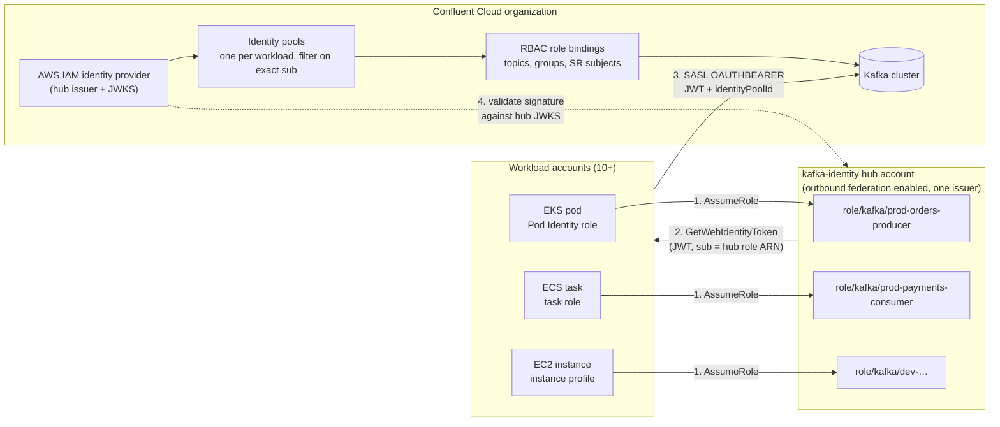
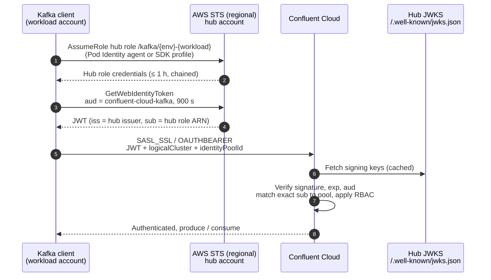

# Confluent Cloud AWS IAM OAuth: Central Token-Minting Account

## Summary

All Kafka clients across 10+ AWS accounts authenticate to Confluent Cloud with AWS IAM OAuth through **one** token-minting AWS account, so Confluent Cloud needs **one** AWS IAM identity provider instead of one per account.

**Problem.** AWS outbound identity federation gives every AWS account its own issuer URL. A Confluent Cloud OAuth identity provider trusts exactly one issuer, and an organization gets 5 OAuth identity providers by default. Federating each account directly needs 10+ providers and a Confluent change for every new AWS account.

**Decision.** Enable outbound identity federation only in a dedicated hub account (`kafka-identity`). Each workload gets its own role in that hub, assumes it with one cross-account hop, and mints its JWT there. Confluent Cloud trusts the hub's issuer once; identity pools filter on the exact hub role ARN in `sub`, so each workload keeps its own identity and RBAC.

**Out of scope.** Human access to Confluent Cloud (SSO), and authorization inside AWS. AWS IAM policies don't govern Confluent Cloud authorization; RBAC on identity pools does.

## Architecture

Workloads stay in their own accounts; only the hub account issues tokens, so Confluent Cloud trusts one issuer whatever the number of AWS accounts.



(1) Each runtime role assumes its own hub role. (2) The hub role mints a short-lived JWT from the hub's single issuer. (3) The client connects to Kafka with that JWT and its identity pool ID. (4) Confluent Cloud validates the signature against the hub's JWKS, matches the exact `sub` to a pool, and applies that pool's RBAC.

## Token flow

A client is two STS calls away from Kafka: one hop into its hub role, one token mint, then a standard OAUTHBEARER handshake.



On EKS, step 1 is done by the Pod Identity agent and the pod only receives hub-role credentials. Everywhere else the AWS SDK does it from the `kafka-hub` profile. The JWT never leaves the client except to go to Confluent Cloud.

## Component design

Every workload has exactly three identity objects: a runtime role in its own account, a dedicated hub role, and a Confluent identity pool pinned to that hub role.

| Component | Lives in | One per | Purpose |
| --- | --- | --- | --- |
| Runtime role | Workload account | Workload | The identity the compute already has (ECS task role, EC2 instance profile, Lambda execution role, EKS Pod Identity role). Only extra right: `sts:AssumeRole` on its hub role. |
| Hub role `/kafka/<env>-<workload>` | `kafka-identity` hub account | Workload | Trusts only that runtime role. Only right: `sts:GetWebIdentityToken` for the Confluent audience. |
| Outbound federation | `kafka-identity` hub account | Hub | Enabled once. Gives the single issuer URL and JWKS that Confluent Cloud trusts. |
| AWS IAM identity provider | Confluent Cloud org | Hub | Issuer URI + JWKS URI of the hub. Uses 1 of the 5 provider slots. |
| Identity pool | Confluent Cloud, under that provider | Workload | Filter on the exact hub role ARN in `sub`; RBAC role bindings to topics, groups, Schema Registry subjects. |

### Hub role: trust policy (ECS, EC2, Lambda source)

Pin the exact runtime role, never the whole account.

```json
{
  "Version": "2012-10-17",
  "Statement": [{
    "Effect": "Allow",
    "Principal": { "AWS": "arn:aws:iam::111111111111:role/orders-producer-task" },
    "Action": ["sts:AssumeRole", "sts:SetSourceIdentity"],
    "Condition": { "StringEquals": { "aws:PrincipalOrgID": "o-exampleorg" } }
  }]
}
```

### Hub role: trust policy (EKS Pod Identity target role)

The source is the cluster's Pod Identity role. Pod Identity passes session tags, so the trust can pin cluster, namespace and service account.

```json
{
  "Version": "2012-10-17",
  "Statement": [{
    "Effect": "Allow",
    "Principal": { "AWS": "arn:aws:iam::222222222222:role/eks-pod-identity-orders" },
    "Action": ["sts:AssumeRole", "sts:TagSession"],
    "Condition": {
      "StringEquals": {
        "aws:RequestTag/eks-cluster-name": "payments-prod",
        "aws:RequestTag/kubernetes-namespace": "orders",
        "aws:RequestTag/kubernetes-service-account": "orders-producer"
      }
    }
  }]
}
```

### Hub role: permission policy

One audience, capped lifetime, no caller-supplied tags (no `sts:TagGetWebIdentityToken`).

```json
{
  "Version": "2012-10-17",
  "Statement": [{
    "Effect": "Allow",
    "Action": "sts:GetWebIdentityToken",
    "Resource": "*",
    "Condition": {
      "ForAllValues:StringEquals": { "sts:IdentityTokenAudience": ["confluent-cloud-kafka"] },
      "NumericLessThanEquals": { "sts:DurationSeconds": 900 }
    }
  }]
}
```

Tag every hub role with `source-account`, `workload`, `environment` and `owner` (see [Naming and tags](#naming-and-tags)). They appear in the token as principal tags and keep the original account visible in audit, which the `aws_account` claim no longer shows.

### Confluent identity pool

- Identity claim: `claims.sub`.
- Filter: `claims.sub == "arn:aws:iam::999999999999:role/kafka/prod-orders-producer"`.
- Role bindings: least privilege per workload (for example DeveloperWrite on `orders.*`, DeveloperRead on its consumer group).

Confirmed by decoding a real token: `sub` is the **full role ARN including its path** (so `/kafka/` appears in it), and `aud` is a plain string. AWS context such as `aws_account`, `org_id`, `ou_path` and principal tags sits under the `https://sts.amazonaws.com/` claim.

## Runtime wiring

Application code never assumes the hub role itself: the platform (EKS) or the AWS SDK credential chain (everything else) does the hop, and the Confluent plugin just calls `GetWebIdentityToken` with whatever credentials it is handed.

| Runtime | How the hop to the hub role happens | Code change |
| --- | --- | --- |
| EKS | Pod Identity association with `role-arn` = cluster's Pod Identity role, `target-role-arn` = hub role. The pod only ever sees hub-role credentials. | None |
| ECS / Fargate | Shared config profile: `role_arn` = hub role, `credential_source = EcsContainer`; set `AWS_PROFILE`. | None |
| EC2 | Same profile with `credential_source = Ec2InstanceMetadata`. | None |
| Lambda consumer (native Kafka trigger, ESM) | Not possible: the ESM can't assume the hub role. See below. | n/a |
| Lambda producer, or self-polling consumer (not recommended) | Same profile with `credential_source = Environment`. | Possibly: Lambda sets its own credentials as environment variables, which can take priority over `AWS_PROFILE` in the SDK credential chain. In Python, use an explicit `boto3.Session(profile_name="kafka-hub")`. The test in this folder logs which identity each approach resolves to. |

### Lambda consumers: the native Kafka trigger (ESM) is the recommended way, and it can't use the hub

The Lambda event source mapping (ESM) is the recommended way to consume Kafka with Lambda: AWS runs the consumer and you only write the handler. A self-polling Lambda that runs its own Kafka client inside the function is **not recommended**, because the function then has to do everything the ESM provides:

- **Offset management:** commit offsets only after successful processing, without losing or reprocessing records when a timeout or error lands mid-batch.
- **Consumer group behavior:** every invocation joins and leaves the group, which triggers a rebalance each time. Concurrent invocations compete for partitions.
- **Scaling:** there are no managed pollers and no lag-based scaling. Throughput is bounded by the schedule and the function timeout, and you have to work out partition-to-concurrency mapping yourself.
- **Polling cost and latency:** the function runs on a schedule even when the topic is idle, and records wait until the next run.
- **Failure handling:** retries, poison-message handling, on-failure destinations, and keeping offsets in order across failed batches.
- **Batching and timeouts:** batch size and batching window have to be stopped cleanly before the function's timeout.
- **Packaging:** the function ships a native Kafka client (librdkafka) and owns token refresh.

However, the ESM's AWS IAM mode (`IAM_OAUTHBEARER_AUTH`) calls `GetWebIdentityToken` **as the function's execution role, in the function's own account**. It has no setting to assume another role first, and the execution role must be in the same account as the function. For a Lambda in a workload account this means:

- **No hub:** the token's `iss` is the workload account's issuer and `sub` is the execution role. Using it requires outbound federation in that account, plus its own Confluent identity provider, which is exactly what this design avoids.
- **No extensions:** this mode accepts only an audience, so no `logicalCluster` or `identityPoolId` SASL extension can be sent.

Lambda consumers are therefore an **exception to the hub model**. Options:

| Option | Recommended | Trade-off |
| --- | --- | --- |
| ESM with `OAUTHBEARER_AUTH` (client credentials) against an external IdP such as Entra ID | Yes, when Lambda consumers span many accounts | One Confluent provider covers all accounts. A client secret per workload is stored in Secrets Manager and has to be rotated. The ESM sends `logicalCluster` and `identityPoolId`. |
| ESM with `IAM_OAUTHBEARER_AUTH` and outbound federation in the workload account | Yes, when only one or two accounts run Lambda consumers | No secrets. Uses one Confluent provider slot per account (5 by default). Needs an exception to the root SCP for that account. |
| Self-polling Lambda with the profile hop to the hub role | No | Works with the hub, but you take on everything the ESM handles (listed above). Only for low-volume or ad hoc use, for example a smoke test. |

### EKS association

```bash
aws eks create-pod-identity-association \
  --cluster-name payments-prod \
  --namespace orders \
  --service-account orders-producer \
  --role-arn arn:aws:iam::222222222222:role/eks-pod-identity-orders \
  --target-role-arn arn:aws:iam::999999999999:role/kafka/prod-orders-producer
```

With a target role, Pod Identity caches credentials for 59 minutes rather than 6 hours; the SDK refreshes them transparently.

### ECS / EC2 / Lambda profile

Ship this file with the container or function and point `AWS_CONFIG_FILE` at it.

```ini
[profile kafka-hub]
role_arn = arn:aws:iam::999999999999:role/kafka/prod-orders-producer
credential_source = EcsContainer
role_session_name = orders-producer
region = eu-west-2
```

```bash
AWS_CONFIG_FILE=/app/aws-config
AWS_PROFILE=kafka-hub
```

Confirm `credential_source` resolution on the AWS SDK version each client stack uses; it is standard in current SDKs but worth one smoke test per language. In particular:

- **ECS:** credentials come from the container credentials endpoint, not from environment variables. The Java SDK v2 and Python default chains check the profile before the container endpoint, so `AWS_PROFILE` is enough.
- **Java SDK v2:** the `sts` module must be on the classpath, or profiles with `role_arn` can't be resolved.
- **.NET and older SDK versions:** verify `credential_source` support explicitly.
- **Lambda:** credentials are set as environment variables, which can take priority over `AWS_PROFILE`. See [Lambda consumers](#lambda-consumers-the-native-kafka-trigger-esm-is-the-recommended-way-and-it-cant-use-the-hub).

### .NET client (`Confluent.Kafka.OAuthBearer.Aws` 2.15+)

Keep `Confluent.Kafka` and the AWS plugin on the same version; they release in lockstep.

```csharp
var config = new ProducerConfig
{
    BootstrapServers = "pkc-xxxxx.eu-west-2.aws.confluent.cloud:9092",
    SecurityProtocol = SecurityProtocol.SaslSsl,
    SaslMechanism = SaslMechanism.OAuthBearer,
    // read by the AWS plugin: STS region + the audience the hub role is allowed to mint for
    SaslOauthbearerConfig = "region=eu-west-2,audience=confluent-cloud-kafka,duration_seconds=900",
    // read by Confluent Cloud
    SaslOauthbearerExtensions = "logicalCluster=lkc-abc123,identityPoolId=pool-orders-producer"
};
// register the plugin's token refresh handler on the builder as shown in the plugin docs
```

Java uses `io.confluent.security.auth.client.oauth.AwsIamJwtRetriever` from `kafka-client-plugins` 8.3+, with the same audience, `extension_logicalCluster` and `extension_identityPoolId`.

### Networking

`GetWebIdentityToken` is not on the global STS endpoint, so clients must use a regional endpoint. Workloads in private subnets need an STS interface VPC endpoint in their own account; the hub account needs no networking at all.

Every region a workload runs in must be **enabled in the hub account**, including opt-in regions. Otherwise the regional STS call into the hub fails for workloads in that region.

## Guardrails

The design only holds if no other account can become an issuer and no one but the pipeline can create hub roles; both are enforced by policy, not convention.

### SCP at the organization root

Stops any spoke enabling outbound federation or minting tokens, which would otherwise lead to a request for another Confluent provider.

```json
{
  "Version": "2012-10-17",
  "Statement": [{
    "Sid": "OnlyHubIssuesTokens",
    "Effect": "Deny",
    "Action": [
      "iam:EnableOutboundWebIdentityFederation",
      "sts:GetWebIdentityToken",
      "sts:TagGetWebIdentityToken"
    ],
    "Resource": "*",
    "Condition": { "StringNotEquals": { "aws:PrincipalAccount": "999999999999" } }
  }]
}
```

### Inside the hub account

- Only the deployment pipeline role may create, update or delete roles under `/kafka/` or change their trust policies (SCP or permission boundary in the hub).
- No human write access to IAM in the hub; read-only for platform engineers via Identity Center.
- Deny `sts:TagGetWebIdentityToken` for every role, so tokens carry only principal tags set by the pipeline.
- No workloads, data or networking in the hub: it holds roles and nothing else.

### Naming and tags

- Hub role: `arn:aws:iam::<hub>:role/kafka/<env>-<workload>`.
- Identity pool: `<env>-<workload>`, matching the hub role name, so audit lines up across AWS and Confluent.
- Required tags on each hub role: `source-account`, `workload`, `environment`, `owner`. IAM tag keys are case-insensitive, so if the pipeline also applies default tags (for example `Owner`), use the same spelling to override them; `owner` and `Owner` together fail with "Duplicate tag keys".

### Audit trail

| Event | Where it is logged | Ties back to |
| --- | --- | --- |
| Runtime role assumes hub role | CloudTrail in the hub (`AssumeRole`) and in the workload account | Source role ARN, source identity |
| JWT minted | CloudTrail in the hub (`GetWebIdentityToken`) | Hub role session |
| Kafka authentication and authorization | Confluent Cloud audit log | Identity pool ID and `sub` |

## Operations

Onboarding a workload or a whole new AWS account is one pull request to the identity pipeline; Confluent's provider configuration never changes.

### Onboarding a workload

1. Team adds an entry to the identity repo: workload name, environment, source account, runtime role ARN (or EKS cluster, namespace, service account), and the topics and groups it needs.
2. Pipeline creates the hub role with its trust policy, permission policy and tags.
3. Pipeline creates the identity pool under the hub's provider with the `sub` filter, and its RBAC role bindings (Confluent Terraform provider).
4. Pipeline grants the runtime role `sts:AssumeRole` on the hub role in the workload account, or creates the EKS Pod Identity association.
5. Team deploys with the profile file or association plus the client config; a smoke test produces or consumes one message.

### Failure modes

| Symptom | Likely cause | Check |
| --- | --- | --- |
| `AccessDenied` on `AssumeRole` | Trust policy pins a different runtime role, or the EKS session tags don't match | CloudTrail in the hub for the denied `AssumeRole` |
| `OutboundWebIdentityFederationDisabled` | Client is minting with workload-account credentials, so the hop never happened | `aws sts get-caller-identity` from the workload should show the hub role |
| `AccessDenied` on `GetWebIdentityToken` | Audience or duration outside the hub role's conditions, or call hit the global STS endpoint | Client `region` / `audience` / `duration_seconds` |
| Kafka `SASL authentication failed` | `sub` or `aud` doesn't match the pool filter, or wrong `identityPoolId` | Decode the JWT; compare with the pool filter |
| Kafka authorization error | Pool exists but lacks the role binding | Confluent Cloud RBAC for the pool |

### Limits to watch

| Limit | Value | Effect on this design |
| --- | --- | --- |
| OAuth identity providers per Confluent org | 5 (default) | Uses 1, leaving 4 for per-environment hubs or other IdPs |
| Identity pools per provider | 1,000 (2,000 with Advanced Security) | Ceiling on workloads per hub |
| Chained role session | 1 hour max | Refreshed by SDK or Pod Identity; no action |
| JWT lifetime | 60 to 3,600 s | Set 900 s; the plugin refreshes before expiry |
| IAM roles per account | 1,000 default, raisable to 5,000 | Hub holds one role per workload; request the increase early |
| STS request rate in the hub account | AWS STS quotas (per account, per region) | All `GetWebIdentityToken` calls run as hub roles and count against the hub; see [Scaling to many ECS / EKS workloads](#scaling-to-many-ecs--eks-workloads) |

### Scaling to many ECS / EKS workloads

ECS and EKS are the best fit for this design. Your own code runs the Kafka client, so the platform (Pod Identity target role) or the AWS SDK (profile hop) does the hop, with no code change. The design scales across many workloads and accounts, but watch the following:

| Concern | Detail | Mitigation |
| --- | --- | --- |
| Identity pools per provider | 1,000, or 2,000 with Advanced Security | One pool per workload, not per pod or task. If you approach the limit, split into one hub per environment, each with its own provider. |
| IAM roles in the hub account | 1,000 default, raisable to 5,000 | Request the increase before onboarding at scale. |
| STS calls concentrated in the hub | Every `GetWebIdentityToken` runs as a hub role, so it counts against the hub account's STS rate limits. Each pod or task refreshes the JWT about every 15 minutes and the role credentials hourly. Steady state is low (5,000 clients at 900 s ≈ 6 requests per second), but mass restarts or deploys cause spikes. | Clients refresh before expiry with jitter. Check the hub account's STS quotas against peak restart scenarios. Use regional STS endpoints, which are required anyway. |
| Regions | Calls go to regional STS endpoints in the hub account | Enable every workload region in the hub account, including opt-in regions. |
| Private subnets | Workloads must reach STS | An STS VPC interface endpoint in each spoke VPC. The hub needs no networking. |
| Shared identity per workload | All pods or tasks of a workload share one hub role, so one `sub` and one pool | Intended: the workload is the unit of access and audit. Use separate hub roles if you need per-cluster or per-region distinction. |
| Onboarding volume | Many workloads mean many changes | One pipeline entry per workload creates the hub role, the pool, the RBAC bindings, and the association or profile (see Onboarding). |
| AWS-managed Kafka clients | Services that connect to Kafka with their own identity can't do the hop | The Lambda native trigger (ESM) is the known case. Check any other managed service before assuming hub support. |

**Validation:** the single-account test in this folder ([README](README.md)) covers the role hop, token claims, the audience and duration caps, the `sub` filter and RBAC. Before rolling out, also test a cross-account EKS Pod Identity target role and the ECS profile hop with a second account in the organization, running a small EKS or ECS workload.

## Trade-offs and open questions

The cost of one issuer is a second hop and a shared trust anchor; both are acceptable if the hub stays empty and pipeline-only.

| Trade-off | Mitigation |
| --- | --- |
| One issuer for all environments: a compromised hub role could reach prod pools if filters were loose | Exact-`sub` filters; split into one hub per environment, each using its own provider slot |
| Token's `aws_account` and `org_id` describe the hub, not the source | Principal tags on each hub role; source identity in CloudTrail |
| Extra STS call per refresh | Off the hot path; tokens refresh roughly every 15 minutes |
| Hub role count grows with workloads | Within IAM role quota; one role per workload is also the audit unit |
| Lambda's native Kafka trigger (ESM), the recommended way to consume with Lambda, can't do the hop | Treat Lambda consumers as an exception to the hub: ESM with an external IdP (`OAUTHBEARER_AUTH`), or per-account federation when few accounts need it. Avoid self-polling Lambdas. |

## Sources

- [Add an OAuth/OIDC identity provider on Confluent Cloud](https://docs.confluent.io/cloud/current/security/authenticate/workload-identities/identity-providers/oauth/identity-providers.html)
- [Configure AWS IAM OAuth for .NET client](https://docs.confluent.io/platform/current/security/authentication/sasl/oauthbearer/aws-iam-dotnet-plugin.html)
- [Configure AWS IAM OAuth for Java client](https://docs.confluent.io/cloud/current/security/authenticate/workload-identities/identity-providers/oauth/clients/aws-iam-java-plugin.html)
- [Confluent Cloud service quotas](https://docs.confluent.io/cloud/current/quotas/service-quotas.html)
- [AWS: getting started with outbound identity federation](https://docs.aws.amazon.com/IAM/latest/UserGuide/id_roles_providers_outbound_getting_started.html)
- [AWS: outbound federation policies](https://docs.aws.eu/IAM/latest/UserGuide/id_roles_providers_outbound_policies.html)
- [AWS: EKS Pod Identity target IAM roles](https://docs.aws.amazon.com/eks/latest/userguide/pod-id-assign-target-role.html)
- [AWS: Lambda Kafka event source mapping authentication](https://docs.aws.amazon.com/lambda/latest/dg/kafka-cluster-auth.html)
