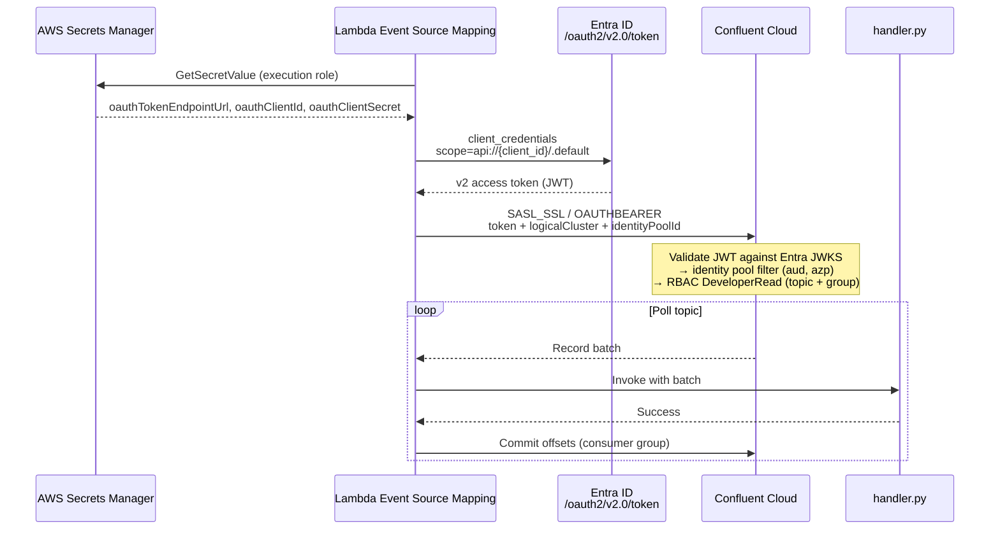

# AWS Lambda Consumer for Confluent Cloud with Entra ID OAuth

An AWS Lambda function that consumes from a Confluent Cloud topic. It authenticates with **Azure Entra ID** OAuth tokens through the Lambda **event source mapping (ESM)** for self-managed Kafka. Terraform sets up the Entra app, the Confluent identity pool and RBAC, and the AWS secret, IAM role, Lambda and ESM. It uses an **existing** Confluent identity provider for your Entra tenant.

This is example code for educational purposes.

## How it works



1. The ESM reads the Entra client credentials from Secrets Manager using the function's execution role.
2. The ESM requests a v2 access token from Entra ID (client-credentials grant). Lambda refreshes it before it expires.
3. The ESM connects to Confluent Cloud over `SASL_SSL` / `OAUTHBEARER` and sends the `logicalCluster` and `identityPoolId` SASL extensions.
4. Confluent Cloud validates the token against the Entra tenant's JWKS. It maps the token to the identity pool whose filter matches (`aud` and `azp` equal the app's client ID), then authorizes it with RBAC (`DeveloperRead` on the topic and the consumer group).
5. The ESM polls the topic, invokes `handler.py` with batches, and commits offsets once the handler succeeds.

**The function has no Kafka client and no credentials.** All Kafka and OAuth work happens in the ESM, so the deployment package is a single Python file.

Reference: [Lambda ESM: OAuth 2.0 authentication](https://docs.aws.amazon.com/lambda/latest/dg/kafka-cluster-auth.html#smaa-auth-oauth)

## What's in this folder

| Path | Purpose |
| --- | --- |
| `handler.py` | Lambda handler. Decodes the base64 key, value and headers and logs each record. Put your logic in `process_record()`. |
| `terraform/versions.tf` | Provider requirements and configuration |
| `terraform/tags.tf` | The `tags` variable, applied to every AWS resource through `default_tags`. Set it in `terraform.tfvars`. |
| `terraform/entra.tf` | Entra app registration, App ID URI, service principal, and the rotating client secret |
| `terraform/confluent.tf` | Lookup of the existing Confluent identity provider, plus the identity pool and role bindings |
| `terraform/aws.tf` | Secrets Manager secret, IAM role, Lambda function, log group, and event source mapping |
| `terraform/variables.tf` / `outputs.tf` | Inputs and outputs |
| `terraform/terraform.tfvars.example` | Example inputs |

## Prerequisites

- **Terraform** 1.5 or later.
- **AWS**: credentials that can create IAM roles, Lambda functions, event source mappings, Secrets Manager secrets, and CloudWatch log groups.
- **Azure**: `az login` to the target tenant, as a user who can create app registrations. Terraform makes that identity the owner of the app and service principal, which it needs to manage them afterwards. Alternatively, set the `ARM_*` environment variables for a service principal with `Application.ReadWrite.All`.
- **Confluent Cloud**:
  - An existing Kafka cluster with a **public endpoint**, and the topic already created.
  - An existing OIDC identity provider for the Entra tenant, with issuer `https://login.microsoftonline.com/<tenant>/v2.0`. Find its `op-` ID with `confluent iam provider list`. Terraform checks at plan time that the issuer matches `entra_tenant_id`.
  - A Cloud API key with OrganizationAdmin, or enough rights to create identity pools and role bindings:

    ```bash
    export CONFLUENT_CLOUD_API_KEY=...
    export CONFLUENT_CLOUD_API_SECRET=...
    ```

## Deploy

```bash
cd lambda-entra-consumer/terraform
cp terraform.tfvars.example terraform.tfvars   # fill in tenant, env, cluster, topic
terraform init
terraform plan
terraform apply
```

`terraform apply` creates the role bindings before the event source mapping, so Lambda's first connection is already authorized. RBAC can still take a minute or two to propagate. If the ESM reports an authorization error right after creation, it recovers on its own.

## Verify

1. **Check the ESM state:**

   ```bash
   aws lambda get-event-source-mapping \
     --uuid "$(terraform output -raw event_source_mapping_uuid)" \
     --query '{State:State,LastProcessingResult:LastProcessingResult,StateTransitionReason:StateTransitionReason}'
   ```

   `State` should be `Enabled`. `LastProcessingResult` should show `OK` or `No records processed`, not an authentication error.

2. **Produce test messages.** For example, with the Confluent CLI:

   ```bash
   confluent kafka topic produce <topic> --cluster <lkc-id>
   ```

   You can also use the EKS producer in the root of this repo.

3. **Watch the function logs:**

   ```bash
   aws logs tail "/aws/lambda/$(terraform output -raw lambda_function_name)" --follow
   ```

   Each record is logged as JSON with its topic, partition, offset, key, value, and headers.

4. **Check the consumer group in Confluent Cloud.** In the Cloud Console, go to Cluster → Clients → Consumers. The `lambda-entra-consumer` group should be listed, with its lag falling to 0.

5. **Optional negative test:** delete `confluent_role_binding.topic_read` (for example with `terraform destroy -target=...`). The ESM should start reporting an authorization error, which shows that access is enforced through the identity pool.

## Inspecting the Entra token

To check the claims Confluent Cloud sees, request a token the same way the ESM does:

```bash
SECRET=$(aws secretsmanager get-secret-value --secret-id "$(terraform output -raw oauth_secret_arn)" --query SecretString --output text)
curl -s -X POST "$(echo "$SECRET" | jq -r .oauthTokenEndpointUrl)" \
  -d grant_type=client_credentials \
  -d client_id="$(echo "$SECRET" | jq -r .oauthClientId)" \
  --data-urlencode client_secret="$(echo "$SECRET" | jq -r .oauthClientSecret)" \
  --data-urlencode scope="$(terraform output -raw entra_scope)" \
  | jq -r .access_token | cut -d. -f2 | base64 -d 2>/dev/null | jq .
```

Expected claims:

- `iss` = `https://login.microsoftonline.com/<tenant>/v2.0`
- `aud` = the client ID
- `azp` = the client ID
- `ver` = `2.0`

If `iss` is `https://sts.windows.net/...`, the app is issuing v1 tokens. Check that `requested_access_token_version = 2` was applied.

## Troubleshooting

| Symptom | Likely cause |
| --- | --- |
| ESM `LastProcessingResult`: SASL authentication failed | The token issuer doesn't match the Confluent identity provider (v1 vs v2 token), or no identity pool filter matched. Decode the token as shown above and compare the claims with the pool filter. |
| Authentication failed, with a "logical cluster" error | `OAUTHBEARER_LOGICAL_CLUSTER` is wrong. It must be the `lkc-` ID of the cluster behind the bootstrap endpoint. |
| Topic or group authorization failed | A role binding is missing, or RBAC hasn't propagated yet. Both the topic **and** the consumer group need `DeveloperRead`. |
| ESM can't read the secret | The execution role lacks `secretsmanager:GetSecretValue`, or the secret is in a different region from the function. |
| `403 Authorization_RequestDenied` ("Request principal is not the owner") when creating the identifier URI, service principal or password | The identity running Terraform doesn't own the app registration. The module sets `owners` to that identity at creation. An app created without owners can't be changed or deleted by a non-admin: remove it from state (`terraform state rm azuread_application.consumer`), apply again, and ask an Entra admin to delete the orphaned app. |
| `AADSTS7000215` invalid client secret | The secret was rotated in Entra but Secrets Manager wasn't updated. Run `terraform apply`. |
| Provider rejects `OAUTHBEARER_AUTH` | The AWS provider is older than 6.70.0. Run `terraform init -upgrade`. |

## Security notes

- **The client secret is stored in Terraform state and in Secrets Manager.** Use an encrypted remote backend with restricted access for state.
- **The secret rotates every `client_secret_rotation_days` (default 180).** When the period expires, the next `terraform apply` creates a new Entra secret and writes it to Secrets Manager. The old secret stays valid for a 7-day overlap. Lambda picks up the new secret without recreating the ESM.
- **The identity pool filter accepts only tokens whose `aud` and `azp` are this app's client ID.** Other apps in the same tenant are not admitted.
- **Delivery is at least once.** On a handler error, the whole batch is retried, so keep `process_record()` idempotent.

## Private networking

This example assumes the Confluent Cloud cluster has a public endpoint. For a cluster on PrivateLink or VPC peering, place the ESM in your VPC. Add `VPC_SUBNET` and `VPC_SECURITY_GROUP` source access configurations, and give that VPC private DNS resolution for the cluster. The subnets also need outbound access to `login.microsoftonline.com` (through a NAT gateway), and either a NAT gateway or a VPC endpoint for Secrets Manager and Lambda/STS.

## Clean up

```bash
terraform destroy
```
